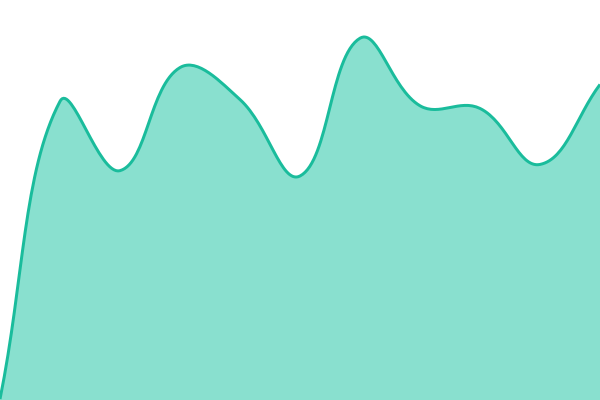
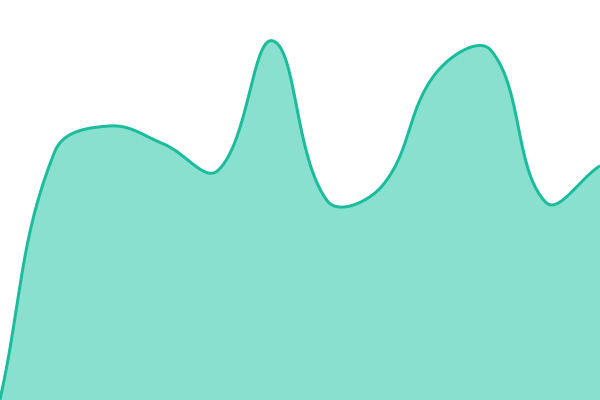
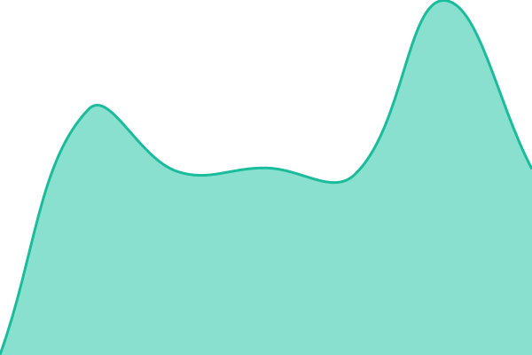

# [📈 Live Status](https://MIERUNE.github.io/kumoy-upptime): <!--live status--> **🟩 All systems operational**

This repository contains the open-source uptime monitor and status page for [MIERUNE Inc.](https://mierune.co.jp/), powered by [Upptime](https://github.com/upptime/upptime).

With [Upptime](https://upptime.js.org), you can get your own unlimited and free uptime monitor and status page, powered entirely by a GitHub repository. We use [Issues](https://github.com/MIERUNE/kumoy-upptime/issues) as incident reports, [Actions](https://github.com/MIERUNE/kumoy-upptime/actions) as uptime monitors, and [Pages](https://MIERUNE.github.io/kumoy-upptime) for the status page.

<!--start: status pages-->
<!-- This summary is generated by Upptime (https://github.com/upptime/upptime) -->
<!-- Do not edit this manually, your changes will be overwritten -->
<!-- prettier-ignore -->
| URL | Status | History | Response Time | Uptime |
| --- | ------ | ------- | ------------- | ------ |
|  [Kumoy Website](https://kumoy.io) | 🟩 Up | [kumoy-website.yml](https://github.com/MIERUNE/kumoy-upptime/commits/HEAD/history/kumoy-website.yml) | 

 517ms
     
 | 

<a href="https://MIERUNE.github.io/kumoy-upptime/history/kumoy-website">100.00%</a>
    

|  [Kumoy App](https://app.kumoy.io) | 🟩 Up | [kumoy-app.yml](https://github.com/MIERUNE/kumoy-upptime/commits/HEAD/history/kumoy-app.yml) | 

 0ms
     
 | 

<a href="https://MIERUNE.github.io/kumoy-upptime/history/kumoy-app">100.00%</a>
    

|  [Kumoy API](https://app.kumoy.io/api/auth/ok) | 🟩 Up | [kumoy-api.yml](https://github.com/MIERUNE/kumoy-upptime/commits/HEAD/history/kumoy-api.yml) | 

 0ms
     
 | 

<a href="https://MIERUNE.github.io/kumoy-upptime/history/kumoy-api">100.00%</a>
    

|  [Kumoy Public Map](https://app.kumoy.io/public/map/6e81496d-77e2-43d5-b6dd-10bf423392e3) | 🟩 Up | [kumoy-public-map.yml](https://github.com/MIERUNE/kumoy-upptime/commits/HEAD/history/kumoy-public-map.yml) | 

 0ms
     
 | 

<a href="https://MIERUNE.github.io/kumoy-upptime/history/kumoy-public-map">100.00%</a>
    

|  [Kumoy Docs](https://docs.kumoy.io) | 🟩 Up | [kumoy-docs.yml](https://github.com/MIERUNE/kumoy-upptime/commits/HEAD/history/kumoy-docs.yml) | 

 0ms
     
 | 

<a href="https://MIERUNE.github.io/kumoy-upptime/history/kumoy-docs">100.00%</a>
    

|  [Kumoy Map Tiles](https://maptiles.kumoy.io/latest/streets/raster/512/0/0/0) | 🟩 Up | [kumoy-map-tiles.yml](https://github.com/MIERUNE/kumoy-upptime/commits/HEAD/history/kumoy-map-tiles.yml) | 

 0ms
     
 | 

<a href="https://MIERUNE.github.io/kumoy-upptime/history/kumoy-map-tiles">100.00%</a>
    

<!--end: status pages-->

[**Visit our status website →**](https://MIERUNE.github.io/kumoy-upptime)

## 📄 License

- Powered by: [Upptime](https://github.com/upptime/upptime)
- Code: [MIT](./LICENSE) © [Anand Chowdhary](https://anandchowdhary.com)
- Data in the `./history` directory: [Open Database License](https://opendatacommons.org/licenses/odbl/1-0/)
